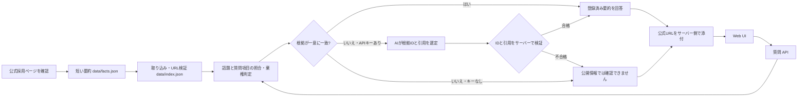

# Future Recruit FAQ Assistant（非公式デモ）

フューチャー株式会社の**公開採用情報**を根拠に質問へ答える、個人制作の新卒Tech選考向けポートフォリオです。**企業の公式サービスではありません。** ロゴ、写真、ページ本文は使用していません。応募条件や待遇は変更され得るため、必ずリンク先の公式情報で最終確認してください。

[ブラウザで試す（APIキー不要）](docs/index.html) · [46問の評価結果](EVALUATION.md)

## 課題

採用FAQは必要な情報が複数の項目に分かれており、知りたい内容の根拠を探す手間があります。一方、自由に文章を生成するだけのチャットボットでは、募集条件や待遇について根拠のない回答を返すおそれがあります。このデモは、**探しやすさと根拠の確認しやすさ**を両立するために作りました。

## 参照元と利用上の注意

- 対象: [フューチャー株式会社・新卒採用情報とFAQ](https://www.future.co.jp/recruit/recruit/rec-fresh/)
- 確認日: 2026年10月13日
- [サイトポリシー](https://www.future.co.jp/site_policy/)はコンテンツの無断複製・転載を制限しています。そのため、このリポジトリにはページHTMLやFAQ本文を取り込まず、確認した事実を短く言い換えた16件の要約、質問語、出典URLのみを収録しました。
- 自動クロールは行いません。公式ページを再確認した後、`data/facts.json` の要約を手で更新して `npm run ingest` を実行します。

## セットアップ

Node.js 18以上だけで動きます。外部パッケージのインストールは不要です。

すぐに画面を試す場合は、同梱の [オフラインHTMLデモ](docs/index.html) をブラウザで開けます。これはルールによるFAQ検索のみで、API通信は行いません。Web版と同じ検索コードをビルド時に埋め込んでいます。GitHub Pagesに公開する場合も、この `docs/` フォルダを配信対象にできます。

```bash
npm run ingest
npm start
```

ブラウザで `http://127.0.0.1:3000` を開きます。Windowsで `npm` が見つからない場合は、`node scripts/ingest.js` と `node src/server.js` でも実行できます。ポート変更は `PORT=3001` などの環境変数で指定します。

要約や検索ルールを更新した場合は `npm run ingest` の後に `npm run demo` を実行し、オフラインHTMLも更新してください。

OpenAI APIを使う場合だけ、サーバー起動前に環境変数を設定します。キーは画面やリポジトリに保存しません。

```powershell
$env:OPENAI_API_KEY = 'your-api-key'
$env:OPENAI_MODEL = 'gpt-5-mini'
node src/server.js
```

`OPENAI_RESPONSES_URL` も変更できます。AI連携は `src/generator.js` の `findEvidence(question, facts)` を実装する別クラスへ交換できます。[OpenAI Responses API の Structured Outputs](https://developers.openai.com/api/docs/guides/structured-outputs?api-mode=responses)を使い、根拠IDと原文どおりの短い引用だけをJSON Schemaで受け取ります。APIキーがない場合はルール検索のみで動き、API障害時には根拠なしとして棄権します。キーを設定しても、ルールで根拠が明確な質問にはAPIを呼びません。APIを呼ぶ際は質問文と登録済みの16件の要約を送信し、画面にその旨を表示します。`store: false` を指定します。

## 構成（アーキテクチャ）



小規模なFAQ向けの検索拡張回答（RAG）です。`data/intent_rules.json` に、各事実の「話題」と「尋ねられる項目」を分けて定義しています。両方が一致し、質問の主要語を十分に説明でき、候補が一つに絞れる場合はその要約を回答に使います。ルールで見つからない言い換えは、APIキーがある場合に限りAIへ16件の短い要約を渡し、根拠IDを選ばせます。AIが返したIDが登録済みで、引用がその要約に実在する場合だけ採用します。回答本文と出典URLはAIに作らせずサーバー側で決定します。年度指定や複数話題にはAPIを呼ばず棄権します。ベクトル検索は使っていません。会話表示は履歴を残しますが、質問同士の文脈は引き継ぎません。

回答は先頭の一文を大きく示し、残りを補足として分け、最後に公式URLを表示します。この表示はWeb版とオフライン版で共通です。

## 評価

```bash
npm run eval
npm test
```

[EVALUATION.md](EVALUATION.md) に46件の質問と結果があります。2026年10月13日の登録データに対して、APIキーなしで **46/46件** が期待する根拠IDまたは棄権に一致しました。根拠なし・年度指定・話題混在・言い換えを含みます。単体テストでは、AIによる言い換え質問の根拠選定、偽の引用・根拠にない詳細の棄権、不要なAPI呼び出しの回避を模擬応答で検証します。この数値は用意した質問集合に対する結果で、未知の質問への一般的な精度を保証しません。

APIキーがある環境では `npm run eval:ai` で [追加の12問](data/ai_eval_questions.json) を実際のAPIに対して評価し、`AI_EVALUATION.md` と `AI_EVALUATION.json` を生成できます。APIキーがないため、このポートフォリオ同梱版には実APIでの評価結果を含めていません。実APIの精度向上は測定前の仮説であり、測定してから判断します。

## 工夫点

- 根拠が見つからないときは「公開情報では確認できません」と返し、確認対象の公式URLも表示します。
- 話題と質問項目を別々に照合し、複数話題の質問には単一FAQを無理に当てず棄権します。
- チャット画面には複数の質問・回答を残し、回答ごとにURLを表示します。
- URLを許可リストで検証し、外部サイトや誤ったリンクの混入を防ぎます。
- サイト本文の転載を避け、短い事実の言い換えを登録しています。
- APIキーなしで検索と評価を再現できます。
- AIは自由文で回答を生成せず、根拠の候補だけを選びます。出力スキーマ、引用照合、出典URLのサーバー管理で、根拠にない事実の混入を抑えています。
- 回答の要点・補足・出典を分けて、採用情報を素早く確認できる表示にしました。

## UI・UXの参考

- [フューチャーの採用サイト](https://www.future.co.jp/recruit/)と[新卒採用FAQ](https://www.future.co.jp/recruit/recruit/rec-fresh/#section3)を2026年10月13日に画面で確認しました。白地と黒の大きな見出し、英語と日本語を組み合わせたセクション名、濃紺・マゼンタ・鮮やかな青、直線的な区切りを参考にしています。主要なアクセント色は画面上のCSSを確認した `#0A1561`、`#E5004F`、`#2C6AE2` です。
- 質問例は角のないカードに短い色分けラインを置き、回答画面は白い余白を広く確保しました。青は送信操作、濃紺は出典、マゼンタは案内のアクセントに使っています。公式サイトのロゴ、写真、アイコン、FAQ本文やデザイン素材は複製していません。
- [デジタル庁デザインシステムのローカルスタイルガイド](https://design.digital.go.jp/dads/guidance/local-design-system/)を参考に、本文・操作部品を16px基準、小さな補助文も14px以上、本文行高を1.5倍以上に設定しました。[テキストエリア](https://design.digital.go.jp/dads/components/textarea/)の考え方に沿って、見えるラベル、300文字の上限表示、文字数カウンターを置いています。キーボードのフォーカス表示と下線付きリンクも実装しています。
- これはフューチャー株式会社やデジタル庁の公式サイト・公式コンポーネントの複製ではなく、独立した非公式デモです。配色の静的な確認はしていますが、画面全体のアクセシビリティ適合を保証するものではありません。

## 改善点と限界

- データは手動更新で、最新情報への自動追従はありません。公開前には公式ページとの照合が必要です。
- 語句ベースの検索なので、登録していない言い換えや複雑な質問では棄権・誤検索が起こり得ます。
- AIが質問の意味を誤読し、関連する別の根拠を選ぶ可能性は残ります。引用が実在しても質問への適合までは機械的に保証できません。重要な情報は出典で確認してください。
- APIルートの実測結果はまだありません。追加評価を実行し、誤選定があれば質問と根拠の組をレビューして改善する必要があります。
- 次の改善は、編集レビュー付きの更新フロー、根拠箇所の細分化、実APIでの人手評価、回答と該当箇所の突合です。

## ポートフォリオでの説明例

> フューチャー株式会社の公開採用FAQを題材に、出典を追える非公式の質問応答デモを作りました。公式ページの本文やロゴを転載せず、確認した事実を短く要約して登録しています。ルールで答えにくい言い換えにはAIが根拠候補を選び、回答文とURLは検証済みデータから表示します。不確かな質問では回答を控え、APIキーなしでも動作します。検索と棄権は46件の質問で検証しました。
